Dialogue Library 概要设计文档
标准化台词视频素材库 · High-Level Design

文档版本：v0.1
文档状态：评审稿，未批准实施
设计对象：Dialogue Library 本地素材库系统
设计深度：系统总体与模块级设计，不包含代码、伪代码、物理表定义、完整 API 协议或开发工期。

# 文档历史发放及记录

| 序号 | 变更（+/-）说明 | 作者 | 版本号 | 日期 | 审核 | 批准 |
| --- | --- | --- | --- | --- | --- | --- |
| 1 | 新建概要设计评审稿 | AI 辅助编写 | v0.1 | 待登记 | 待评审 | 未批准 |

文档适用于产品确认、架构评审及后续 AI Agent 实现任务拆解。当前工程内已发现 PRD、完整功能清单和需求矩阵，尚未发现应用源码、构建配置或部署配置；本文描述目标架构，不代表已有实现或实测能力。

标记约定：

- 已确认约束：来自用户讨论和现有需求文档。
- 设计建议：本文提出的架构选择，需评审，不自动视为已批准。
- 待确认：依赖产品规则、专项技术设计或验证的内容。

# 1 引言

## 1.1 背景

台词视频通常分散存放，视频、字幕和来源信息缺少一致关联，人工难以检索和复用，自动剪辑程序也缺乏稳定访问方式。

Dialogue Library 以已剪辑视频为素材管理单位，将 Video + SRT 通过确定性的程序处理，形成 Video + SRT + JSON 的标准化存储及可查询记录。人工用户通过管理页面使用素材，外部程序通过接口检索和获取素材。

基础建库不依赖 ASR、Embedding 或视觉模型。语义向量、情绪分析和视觉理解作为入库后的可选增强。上游准备和下游剪辑与素材库主体解耦。

本设计适用于本地 Web 管理界面、业务服务、后台处理和本地存储，不采用 Android 工程模板，不预设云平台或多租户架构。

## 1.2 术语和缩略语

| 缩略语/术语 | 全称 | 说明 |
| --- | --- | --- |
| Asset | 视频素材 | 一个独立视频及其关联资源、工作数据和状态；不是一句台词 |
| Dialogue | 结构化台词条目 | 文本、顺序、相对当前视频的起止时间；一个 Asset 可有多条 |
| SRT | SubRip Subtitle | 标准输入中的配套字幕；字幕条目不必等于完整自然语言句子 |
| JSON | JavaScript Object Notation | 标准化元数据的文件表达形式，不包含具体代码实现 |
| Resource | 资源 | 原视频、字幕、JSON、缩略图、预览等文件的角色与关联 |
| ASR | Automatic Speech Recognition | 上游可选语音识别，不属于基础入库强制步骤 |
| OCR | Optical Character Recognition | 上游可选画面字幕识别 |
| Embedding | 语义向量 | 可重建的语义检索数据，必须关联生成模型和输入版本 |
| FTS | Full-Text Search | 基础关键词全文检索，无需 AI 模型 |
| Worker | 后台执行进程 | 执行持久化任务及耗时媒体处理 |
| Revision | 数据修订版本 | 用于区分工作数据、导出快照和派生结果是否对应同一输入 |
| 租约 | 有时效的任务执行权 | 进程中断后可识别失效执行权，避免任务永久卡住 |
| 标准化完成 | 基础业务状态 | 三件套及基础记录已满足规则，不等于全部预览和 AI 增强成功 |

## 1.3 参考资料

- [产品需求文档](Dialogue-Library-PRD.md)：产品定位、输入输出、范围与质量约束。
- [完整功能清单](Dialogue-Library-Functional-Checklist.md)：需求编号、优先级、验收要点和 DEC 决策编号。
- [需求交付矩阵](Dialogue-Library-Requirements-Matrix.md)：依赖、交付物、证据和执行状态。
- 用户讨论：标准输入 Video + SRT；标准存储 Video + SRT + JSON；基础库不依赖 AI；不覆盖原始媒体；不按人天及日历日期编排 AI Agent 任务。

本文未引用未经检索验证的第三方兼容性或性能结论。候选组件的版本、许可及实际支持范围在专项设计中核验。

# 2 需求分析

## 2.1 需求概述

### 2.1.1 需求背景

核心诉求是将不同来源的台词视频转为统一可管理资产，建立人工管理与程序化访问共用的素材库，而不是建设完整自动剪辑系统。

### 2.1.2 需求列表

需求来源采用现有功能编号，不虚构 Jira 或 Issue ID。

- P0：IMP、VAL、STO、MED、DLG、META、MGT、PLAY、SRCH、SRC、JOB、CORE。
- P1：SEM、EMO、VIS、AIM、EXT。
- P2：ADV、PER、REC、CUT。
- 可选上游：PREP，不自动纳入版本承诺。
- 跨功能质量：QLT；产品决策：DEC；验收场景：CASE。

各编号以完整功能清单和需求矩阵为准，本文按模块建立映射，不重新分配原编号。

### 2.1.3 需求范围及限制

已确认：

- 当前只管理已剪辑视频，允许单句、多句和台词前后画面。
- 标准输入是 Video + SRT，标准化存储是 Video + SRT + JSON。
- 有效视频可被接纳；仅视频如何展示、何时达到完整标准状态仍待 DEC-001 确认。
- 核心建库与关键词检索不依赖 AI 和在线 API。
- 用户确认导入后自动执行处理，无额外默认强制收录审批。
- 不要求预先统一媒体格式或文件名；必要时生成预览副本。
- 不修改原视频和原始配套文件。

不在本期强制范围：长视频加工、完整剪辑时间线、平台抓取、云端协作、人物身份自动认定及授权合法性自动认定。

### 2.1.4 需求整体目标

功能目标：形成可管理、浏览、播放、分类、删除、筛选和关键词搜索的标准素材库，并为可选 AI 增强和外部自动化提供稳定边界。

非功能目标：本地优先、原件保护、异步、增量、可恢复、可观测、接口优先、索引可重建。量化规模与性能指标待 DEC-012 和真实样本验证，不提前给出未测试承诺。

## 2.2 需求分析

### 2.2.1 竞品分析

本阶段未开展独立竞品调研，不对任何产品的能力或性能作未经核实的判断。可参考的产品类型仅用于边界比较：

| 类型 | 可借鉴能力 | 本系统不应隐含继承的范围 |
| --- | --- | --- |
| 本地媒体管理工具 | 浏览、分类、文件关联、预览 | 不代表已支持所有媒体格式 |
| 字幕制作工具 | 时间轴与文本修订 | 不自动建设完整字幕制作器 |
| 视频剪辑工具 | 素材交付和时间范围定位 | 不建设完整成片编辑系统 |
| 语义检索工具 | 向量与关键词结合 | 不把 AI 变成入库和基础搜索门槛 |

素材来源可以是任意渠道，不绑定特定平台。是否开展专项竞品调研不阻塞本文架构评审。

### 2.2.2 功能性需求分析

| 功能性需求编号 | 需求说明 | 优先级 | 备注 |
| --- | --- | --- | --- |
| IMP、VAL | 导入、配对、校验和精确去重 | P0 | 去重先于昂贵处理；不静默处理歧义 |
| STO、MED | 文件保护、媒体信息、缩略图、兼容预览 | P0 | 派生处理不改原件 |
| DLG、META | SRT 标准化、台词维护、JSON 构建 | P0 | 原始字幕与可编辑台词分离 |
| MGT、PLAY、SRC | 管理页面、播放定位、来源维护 | P0 | Asset 是展示和管理单位 |
| SRCH | 关键词、组合筛选和索引重建 | P0 | 命中返回父素材和台词区间 |
| JOB、CORE | 持久化异步任务、恢复和业务接口 | P0 | 不只存在 UI 内部调用 |
| SEM | 语义向量及混合检索 | P1 | 模型与输入版本隔离 |
| EMO、VIS、AIM | 情绪、视觉和模型生命周期 | P1 | 独立启用、可失败、可重算 |
| EXT | 外部说明、Agent 和剪辑程序适配 | P1 | 不预设某第三方已经兼容 |
| ADV、PER、REC、CUT | 相似去重、人物、推荐、派生剪切 | P2 | 专项方案后续设计 |
| PREP | ASR、OCR、字幕准备和长视频加工 | 可选 | 基础入库不调用这些能力 |

### 2.2.3 非功能性需求分析

| 非功能性需求编号 | 需求说明 | 优先级 | 备注 |
| --- | --- | --- | --- |
| NFR-01 | 本地离线基础建库 | P0 | 无模型、无在线 API 时标准输入可用 |
| NFR-02 | 原始素材及人工修订保护 | P0 | 用原件校验和修订保护测试验证 |
| NFR-03 | 后台处理与增量更新 | P0 | 耗时操作不占用请求全生命周期 |
| NFR-04 | 恢复、幂等、错误可追查 | P0 | 中断和重复提交测试 |
| NFR-05 | 资源和成本可控 | P0 | 不无界缓存、无界并发或全量重算 |
| NFR-06 | 文件与网络访问安全 | P0 | 不默认向网络公开本地文件 |
| NFR-07 | 可重建索引和可维护契约 | P0 | 原始文件、工作数据和索引分离 |
| NFR-08 | AI 可插拔、故障隔离 | P1 | 未启用不加载模型依赖和权重 |
| NFR-09 | 性能达标 | 待定义阈值 | 场景和规模确定后再形成量化验收 |

NFR 编号仅供本 HLD 内追踪，不替换来源文档的功能编号。

### 2.2.4 设计约束分析

性能：延迟、吞吐、并发阈值待确认；使用分页、后台任务、有限并发和增量索引控制增长。

硬件 / 云资源平台约束：面向个人本地部署，目标操作系统、GPU 和资源预算仍需作为部署输入确认。此前 Ubuntu 与指定显卡只是讨论上下文，不将当前文档编写机器等同于最终运行环境。基础库不要求 GPU。

软件平台 / 运行时约束：推荐轻量模块化单体与独立 Worker；具体语言、数据库和运行版本是设计候选，不是已批准事实。

成本 / 资源：视频为主要磁盘占用，托管复制和预览会增加空间；不默认部署独立搜索集群、消息中间件或云服务。

安全合规：只处理用户授权访问的文件；记录未知授权，不将识别出作品视为获得许可。

全球化：保证中文文件名、字幕和搜索处理；多语言 UI、时区显示和暗黑模式范围待评估。

三方软件/开源软件使用规范：依赖、媒体处理组件和模型需分别核查许可与分发方式，不能将某构建的许可推及所有构建。

### 2.2.5 依赖分析

外部模块依赖：本地文件系统、媒体探测及处理工具、浏览器播放能力；可选 AI 推理适配器。基础系统无在线推理依赖。

内部模块依赖：导入编排依赖存储、校验、台词和元数据契约；搜索依赖有效工作数据；UI 和 Agent 均依赖业务接口；AI 读取已有素材但不成为基础服务启动前提。

### 2.2.6 影响分析

当前为新系统设计，未发现现有应用需要迁移；后续不能据此假定用户导入历史文件没有兼容成本。

与需求矩阵衔接：本文建立 D-01～D-08 的总体职责，不将其全部标为完成；流水线、数据模型、搜索、推理、API 和页面专项设计仍需分别展开。原 PRD 与矩阵中的 DEC 决策仍保留待确认。

# 3 总体架构设计

## 3.1 零层设计（本系统在上级系统中的位置）

系统为独立本地产品，不隶属于已确认的更高层平台；在内容生产链路中的位置如下。

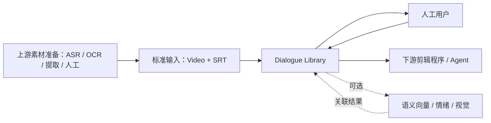

上游流程非固定，系统只消费约定资源；下游通过接口获取素材，不直接写内部数据库。未来长视频加工产物也需要用户确认导入。

## 3.2 一层设计

### 3.2.1 系统总体结构框图

设计建议：采用模块化单体业务服务，加独立后台 Worker；共享明确的业务契约与本地持久化，不采用微服务和独立消息集群。

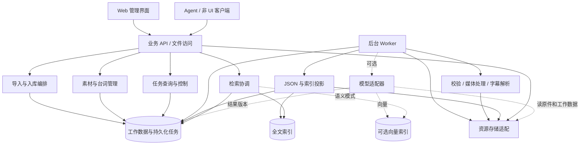

图中模块是职责边界，不代表每个框都需独立进程。API 负责受控访问，Worker 负责耗时步骤；文件、数据库与索引之间采用可恢复的发布和版本对齐，而不是假定存在跨介质原子事务。

### 3.2.2 场景时序图/整体关键流程

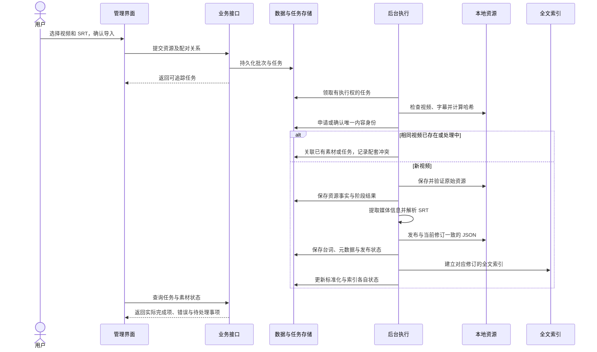

这是有效标准输入的成功与重复分支概览，不是详细执行算法。完整时间戳检查需媒体时长支持，因此“素材校验”可有初查与媒体探测后的复核，不因概念步骤顺序而重复探测。仅视频、异常字幕和配套冲突按待确认策略分支；不自动调用 AI 补齐。

### 3.2.3 模块分解

| 功能需求 | 接入与编排 | 存储与媒体 | 工作数据管理 | 检索 | 任务执行 | 可选 AI |
| --- | --- | --- | --- | --- | --- | --- |
| IMP、VAL | 主责 | 协作 | 协作 | — | 协作 | — |
| STO、MED | 协作 | 主责 | 协作 | — | 协作 | — |
| DLG、META | 协作 | 协作 | 主责 | 投影更新 | 协作 | — |
| MGT、PLAY、SRC | 接口 | 文件服务 | 主责 | 筛选协作 | 状态协作 | — |
| SRCH | 接口 | — | 数据来源 | 主责 | 重建任务 | — |
| JOB、CORE | 主责 | 交付协作 | 状态与契约 | 查询协作 | 主责 | 可选 |
| SEM、EMO、VIS、AIM | 接口 | 输入读取 | 版本与修订 | 语义查询 | 执行调度 | 主责 |
| ADV、PER、REC、CUT | 后续扩展 | 派生协作 | 关联记录 | 推荐协作 | 后台处理 | 按需 |

## 3.3 开发和运行环境

下列为沿用初步讨论的候选方案，待技术验证，不宣称已安装或已运行。

| 技术层 | 候选 | 选择理由与待验证点 |
| --- | --- | --- |
| 前端 | Vue 3 + TypeScript | 适配本地管理界面；播放器支持范围需样本验证 |
| 业务服务 | Python + FastAPI | 与媒体处理和可选模型生态对接；保持服务与耗时任务隔离 |
| 数据访问 | SQLAlchemy | 管理业务实体与事务，迁移方式另定 |
| 元数据与任务 | SQLite | 单机轻量持久化；并发写、恢复与规模边界需测试 |
| 全文检索 | SQLite FTS5 配合中文处理 | 中文分词与短查询策略专项验证，不直接将 Trigram 当作等价替代 |
| 向量检索 | sqlite-vec 等本地方案 | 仅 P1 需要；扩展加载、分发及模型空间隔离需验证 |
| 媒体处理 | FFprobe / FFmpeg | 探测、缩略图和预览，不覆盖原件；确认实际构建支持与许可 |
| 后台任务 | 持久化任务记录 + Worker | 无需 Redis；处理领取、幂等和租约恢复 |
| Python 环境 | uv + 项目内虚拟环境 | 隔离依赖，不污染系统 Python；模型依赖按能力分组 |
| 桌面封装 | 后续可选 Tauri | 不作为基础 Web 使用的前提 |

模型型号和推理引擎不在本文锁定。基础部署不要求模型权重、GPU、独立向量数据库、Redis、PostgreSQL、Elasticsearch、Agent 框架或云账号。

## 3.4 模块开发方式说明

- 同一工程内按领域模块组织业务，接口、Worker 复用业务契约而非重复实现规则。
- UI 不直接读写数据库或任意本地路径，核心操作经应用服务。
- 将文件系统、媒体工具、检索和模型访问放在适配边界，便于替换和测试。
- AI Agent 按可独立验证的任务交付，记录需求编号、设计版本、改动边界和真实证据，不估人天或日历工期。
- 先形成无 AI 标准输入闭环，再扩展管理、异常恢复和可选增强；前后端可在契约明确后并行。

## 3.5 技术方案风险点

| 风险 | 影响 | 应对设计 | 待决条件 |
| --- | --- | --- | --- |
| JSON 与数据库双重编辑 | 人工内容丢失、导出不一致 | 单一工作写入口、修订版本与投影状态 | DEC-007 |
| 原始字幕与修订台词不一致 | 交付字幕与 JSON 矛盾 | 原件独立、明确交付版本，禁止误标同版本 | DEC-006 |
| 文件与数据库无法共同提交 | 半完成资源、孤立文件 | 阶段记录、发布清单、幂等重试和对账 | 流水线设计 |
| 重复并发导入 | 同文件多份存储 | 内容身份唯一约束和任务执行权 | 数据设计 |
| 外部引用路径移动 | 素材失效 | 明确托管策略及完整性检查 | DEC-002 |
| 不兼容媒体或时间偏移 | 无法播放或定位错误 | 按需预览、真实样本与时间对应验证 | 支持清单待验证 |
| SQLite 写竞争与磁盘不足 | 请求变慢或处理失败 | 短事务、有限并发、磁盘检查与重试分类 | DEC-012 |
| 中文短查询漏检 | 搜索不可用 | 建立短词与长句样本，专项选择检索策略 | 搜索设计 |
| AI 依赖拖慢基础启动 | 无模型无法运行 | 可选加载、独立任务与故障隔离 | 推理设计 |
| 不可信媒体、路径与 JSON | 越权、资源耗尽或注入 | 路径边界、工具超时、输入校验、输出转义 | 安全评审 |

# 4 二层设计（模块内部设计）

## 4.1 入库编排与任务模块设计

### 4.1.1 分模块结构图


编排定义阶段与依赖，执行器负责运行和状态；校验、存储等能力不各自创建无法追踪的后台任务。

### 4.1.2 模块流程图

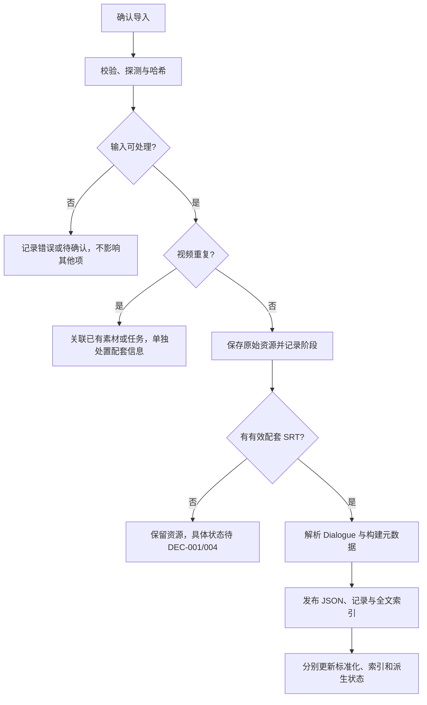

文件校验、媒体提取和字幕复核允许共享探测结果，不改变用户确认的逻辑流程，也不让重复资源执行无必要的转码。

### 4.1.3 模块时序图

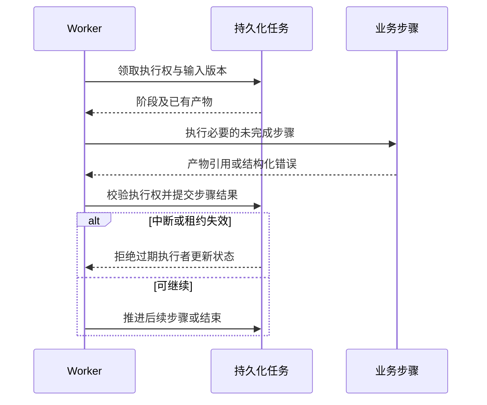

重试时先核对输入版本与产物有效性。建议采用至少一次执行和幂等提交，不承诺外部工具“恰好一次”运行。

### 4.1.4 模块其他说明

对应 IMP、VAL、JOB。持久化保存批次、单项任务和步骤状态；请求成功仅表示任务已接收，不表示所有素材完成。

配对不明、重复配套冲突可以等待用户决策，但不等于新增强制收录审批。部分错误的阻断级别由 DEC-003～DEC-005 决定。

## 4.2 资源与媒体模块设计

### 4.2.1 分模块结构图

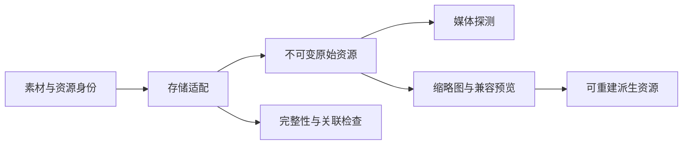

托管复制为建议默认方案，理由是更稳定地保护和访问资源；是否采用、是否允许外部引用仍由 DEC-002 确认，本文不直接关闭该决策。

### 4.2.2 模块流程图

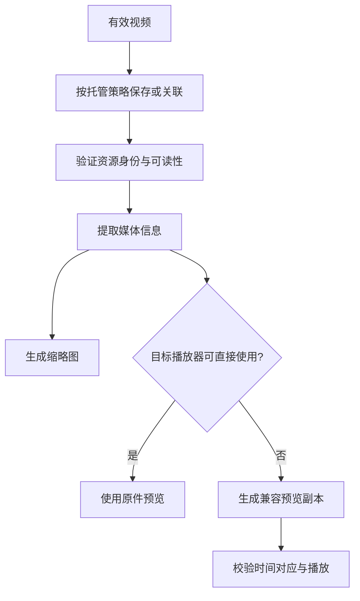

缩略图和预览是独立派生任务，可失败重试。预览是否可用不能仅由文件后缀决定，也不能由服务端解码成功直接推断浏览器一定支持。

### 4.2.3 模块时序图

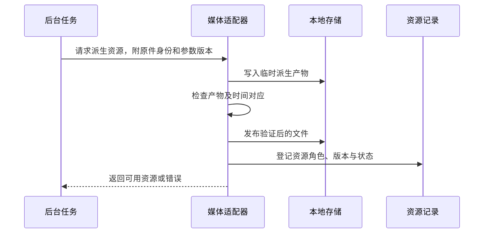

在同文件系统内建议用安全发布方式减少半文件可见；跨磁盘复制不能假定重命名天然原子，应由存储适配器提供不同的完成判定。

### 4.2.4 模块其他说明

对应 STO、MED、PLAY、CORE 文件交付部分。路径由服务受控解析，客户端通过资源标识访问；不开放任意路径读取。删除前核查资源是否仍被其他素材或任务引用，具体删除语义待 DEC-008。

## 4.3 字幕、元数据与素材管理模块设计

### 4.3.1 分模块结构图

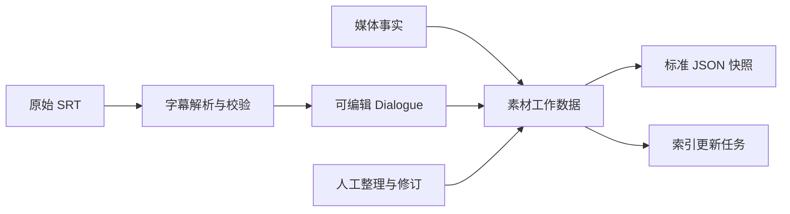

三层数据与人工修订并存：原件只读，基础事实程序提取，AI 结果可选；人工信息不是可随模型重算丢弃的缓存。

### 4.3.2 模块流程图

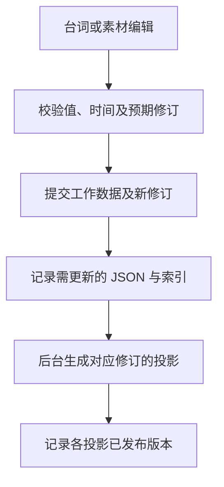

设计建议：以数据库中的工作数据作为编辑事实源，以标准 JSON 为可交付快照，统一写入口，不默认支持用户直接修改库内 JSON 后反向覆盖。此建议须 DEC-007 评审后生效。

### 4.3.3 模块时序图

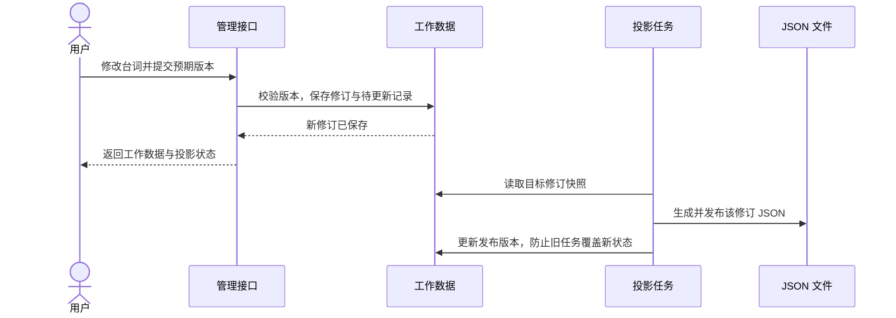

使用版本冲突反馈避免 UI、接口和 Worker 并发覆盖。JSON 暂未发布时，不声称标准包已与最新编辑一致。

### 4.3.4 模块其他说明

对应 DLG、META、MGT、SRC。分类、标签与来源编辑不触发语音或视觉识别。台词修改只使依赖该文本的索引或增强结果需要更新。

原始 SRT 保留；建议将修订字幕作为独立产物，在导出时明确原始版或修订版，不能把修订 JSON 与旧 SRT 标为同一一致版本。是否生成修订 SRT 以及默认交付哪个版本待 DEC-006。

语言可未知，标题默认规则待定；不因缺乏 AI 推断而阻塞基础建库。无台词视频能否标为标准化完成由 DEC-004 决定。

## 4.4 检索模块设计

### 4.4.1 分模块结构图

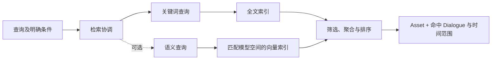

基础关键词和语义模式明确区分；混合模式不能静默伪装成纯语义成功。向量能力不可用时返回原因及可用关键词选择，具体降级契约待 API 设计。

### 4.4.2 模块流程图

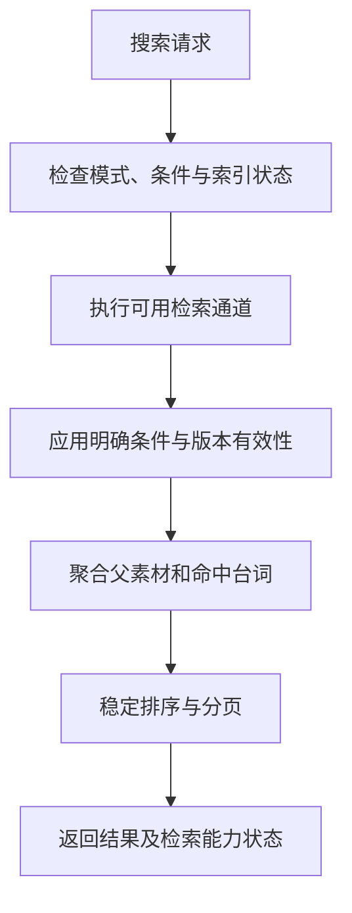

筛选策略需避免向量召回后过滤导致有效候选遗漏；具体预过滤、扩召回与融合策略在搜索专项设计中验证，不把上述概念顺序当作固定算法。

### 4.4.3 模块时序图

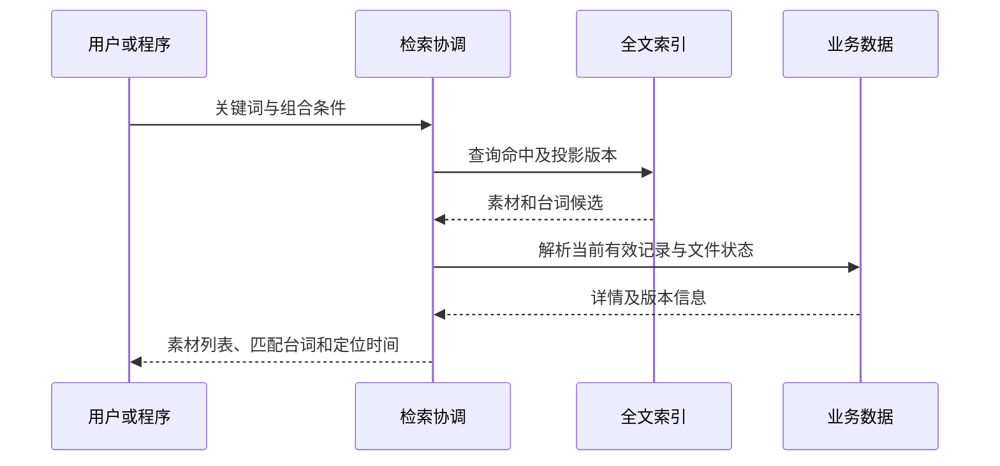

编辑后索引存在短暂滞后时必须可识别；允许延迟范围、用户提示和重建期间行为待专项设计，不承诺未经实现的零停机重建。

### 4.4.4 模块其他说明

对应 SRCH、SEM、REC。全文索引和向量索引均是派生投影，不是人工工作数据唯一存储。中文测试覆盖单字、双字、完整句和标点变化。重建全文无需模型，重建向量索引与更换模型重新生成向量是不同操作。

## 4.5 可选 AI 增强模块设计

### 4.5.1 分模块结构图

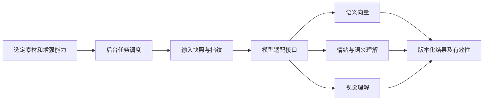

三种能力逻辑独立。模型适配接口统一能力契约与错误，不要求所有模型使用同一个推理引擎或同时常驻显存。

### 4.5.2 模块流程图

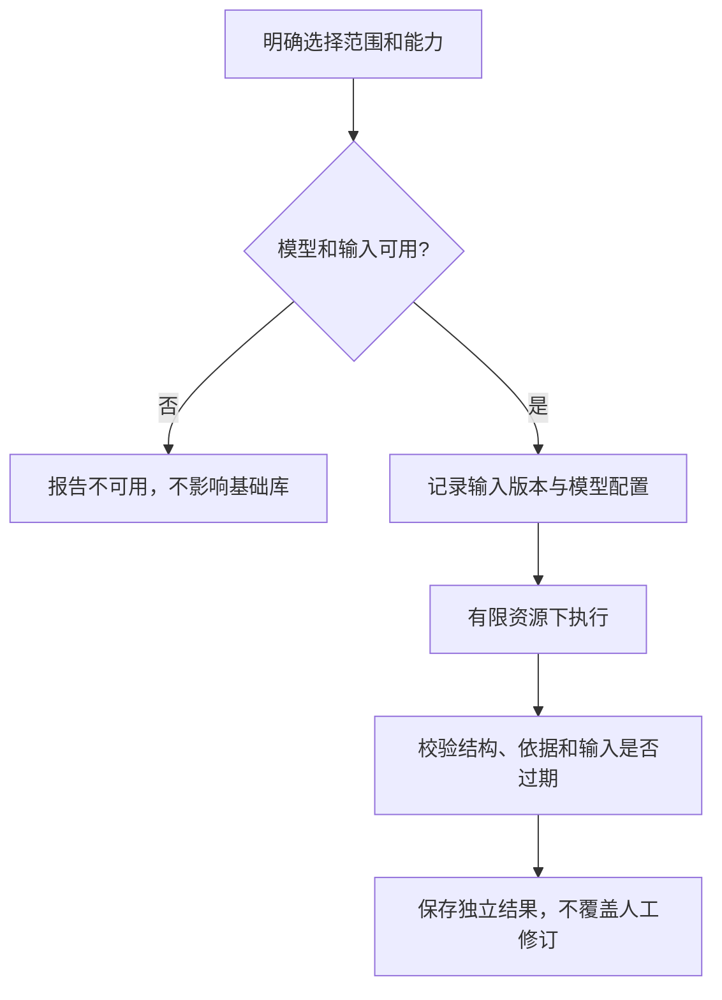

输入在分析期间变化时，结果可保留为旧版本，但不能被标为对应最新输入的有效结果。

### 4.5.3 模块时序图

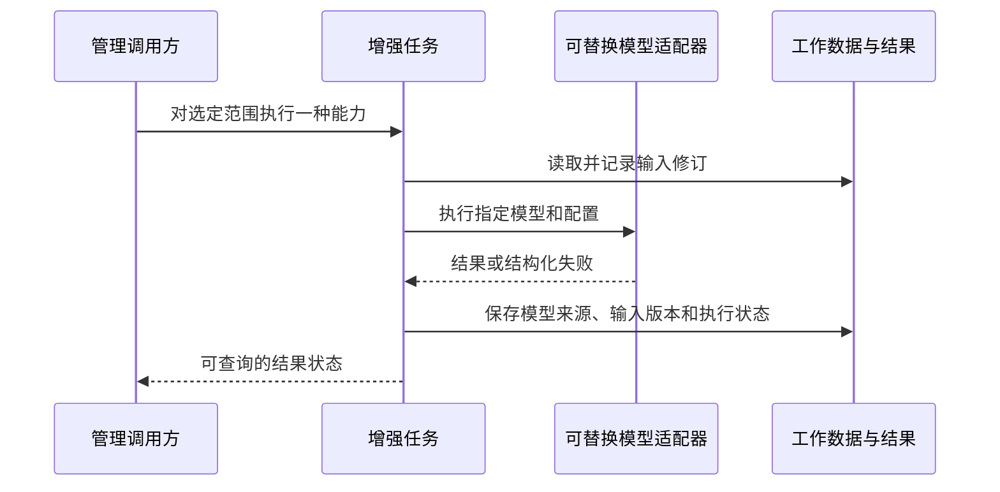

模型失败只影响当前能力，不能将素材主记录标为不存在或删除其基础索引。

### 4.5.4 模块其他说明

对应 SEM、EMO、VIS、AIM。向量记录模型空间、配置与输入指纹，不只记录一个模型名字。情绪结果区分文本推断和视听依据；素材级与台词级分析不可混用。

ASR/OCR 如后续纳入，放在上游准备适配器，产出 SRT 后进入同一固定流程，不注入基础入库必经链路。

## 4.6 管理界面与对外访问模块设计

### 4.6.1 分模块结构图

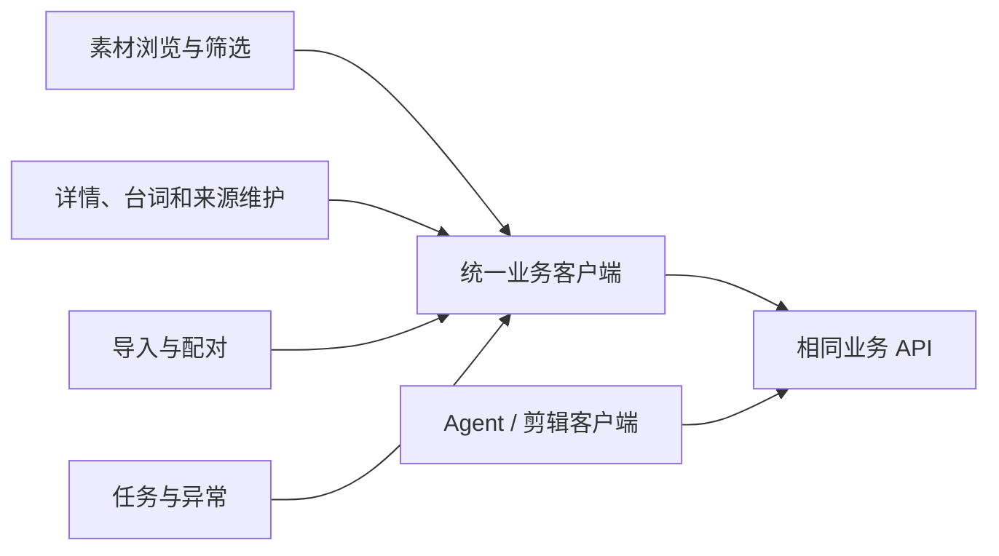

管理页面是核心业务接口的消费者，不拥有绕过后端规则的私有写通道。

### 4.6.2 模块流程图

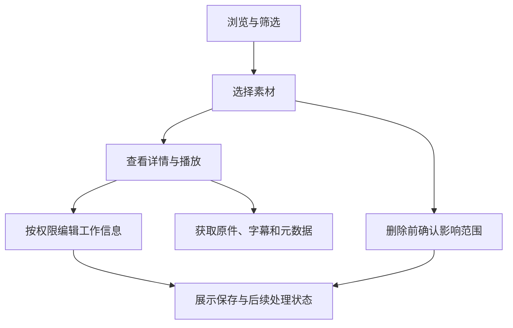

页面布局、卡片或表格切换、批量选择反馈和错误交互在页面专项设计中确定，不将本文示意视为最终原型。

### 4.6.3 模块时序图

```mermaid
sequenceDiagram
    participant Client as UI 或外部程序
    participant API as 业务接口
    participant Store as 资源与业务数据
    Client->>API: 按素材 ID 请求详情和可用资源
    API->>Store: 校验资源角色、状态及访问边界
    Store-->>API: 当前元数据和受控资源引用
    API-->>Client: 区分原件、预览及字幕版本
    Client->>API: 请求某项资源内容或播放范围
    API-->>Client: 文件内容或明确错误
```

文件访问不能由客户端随意传入系统路径。网络客户端不能使用仅在服务端有效的绝对路径替代实际可访问资源。

### 4.6.4 模块其他说明

对应 MGT、PLAY、CORE、EXT。基础 API 从 P0 提供，外部说明和 Agent 适配在 P1 完善；不要求部署 Agent 框架。Concat、OpenMontage 等具体兼容性需实际对接后才能宣称。

# 5 接口设计

## 5.1 提供接口

### 5.1.1 外部接口

以下是能力级契约，具体路径、请求字段和错误码在 API 规范中确定。

| 接口组 | 核心操作 | 主要输出与约束 |
| --- | --- | --- |
| 导入 | 扫描、配对、提交和补充字幕 | 返回批次与单项引用，不在提交成功时宣告全量完成 |
| 素材管理 | 列表、详情、编辑、分类、标签、收藏、删除 | 稳定素材 ID、修订信息和批量部分失败结果 |
| 台词 | 查询、增删改、时间修正 | Dialogue 与 Asset 关联；变更不裁切视频 |
| 检索 | 关键词、筛选、可选语义与混合 | 父素材、匹配台词和时间范围，能力状态明确 |
| 文件 | 原件、字幕、JSON、缩略图、预览获取 | 角色、版本和可用性明确；支持适合播放器的范围读取设计 |
| 任务 | 查询、失败重试、处理历史 | 分阶段状态和可操作原因；暂停取消尚未批准 |
| AI 增强 | 能力查询、指定范围执行、结果修订 | 可选、不阻塞基础库、模型输入版本可追溯 |
| 运维操作 | 完整性检查、索引重建 | 范围明确、结果可追踪，不允许任意路径执行 |

外部契约需提供分页边界、输入上限、版本冲突、重试语义和结构化错误。局域网开放、身份认证方式和写权限由 DEC-011 确认；API 优先不等于默认公开访问。

### 5.1.2 内部接口

| 契约 | 调用方 → 提供方 | 内容与不变量 |
| --- | --- | --- |
| 资源保存 | 编排 → 存储 | 输入引用、内容身份、资源角色、完成或失败结果 |
| 媒体处理 | Worker → 媒体适配器 | 原资源、处理配置、产物与时间对应，不覆盖原件 |
| 字幕解析 | Worker → 字幕模块 | 原始 SRT、文本及毫秒时间、校验问题 |
| 工作数据修订 | 管理/编排 → 数据服务 | 预期版本、人工保护、原子工作数据更新 |
| 投影发布 | Worker → JSON/检索模块 | 源修订、目标产物、已发布版本与错误 |
| 任务执行 | 调度 → Worker | 步骤、输入版本、执行权与已提交结果 |
| 模型执行 | 增强 Worker → 适配器 | 能力、输入快照、模型与配置、结果依据 |
| 资源交付 | API → 存储 | 素材身份、资源角色与版本，而非不受控路径 |

内部逻辑通知可以由持久化任务记录表达，不要求消息总线。需要可靠投影更新时，建议将工作修订与待更新记录一起提交，避免提交数据后进程中断导致索引更新永久遗漏。

## 5.2 依赖接口

- 文件系统：受限目录、文件读写、空间检查及发布能力。
- 媒体工具：本地进程调用边界，参数结构化、超时和产物验证。
- 数据库：短事务、唯一内容约束、任务领取与修订检查。
- 全文与可选向量检索：查询、增量更新、删除与重建契约。
- 可选模型：能力探测、版本、执行与结构化失败；不绑定在线供应商。
- 下游：目前没有经过验证的专用协议，待外部集成设计确认。

# 6 非功能设计

## 6.1 性能

采用分页和按需详情，避免一次加载全库台词、缩略图或视频。扫描、哈希、转码、索引重建及 AI 任务后台运行；请求主要进行校验与持久化提交。

建立真实媒体与中文查询基准，测量列表、检索、导入、恢复和重建。目标规模与阈值待 DEC-012；本稿不宣称任何延迟或吞吐已达到。

## 6.2 成本 / 资源

基础服务无 GPU 要求。磁盘考虑原始资源、可选托管副本、缩略图、预览、临时文件、数据库和索引。模型权重和推理缓存仅在启用时增加。

导入和大规模派生前检查可用空间，失败保留已保存资源及阶段记录。派生清理范围需与删除、引用和任务状态联动，不能按目录年龄盲删原件。

## 6.3 内存

视频读取、哈希和复制使用有界流式处理思路，不将整批视频载入内存。字幕解析设置合理输入上限和错误反馈，具体数值待验证。

缩略图缓存、数据库连接与媒体子进程受限；AI 模型按能力加载，是否卸载和共享由推理专项设计决定，不承诺多个大模型可同时常驻显存。

## 6.4 可靠性（DFR）

- 任务持久化，单项错误不阻塞整批。
- 至少一次执行配合幂等发布，不宣称所有外部处理恰好一次。
- 使用唯一内容身份防止重复导入，使用输入版本避免旧结果覆盖新修订。
- 将数据库事务与文件发布分开记录、恢复和对账。
- 临时资源写入成功不等于正式资源完成，发布后才更新可用状态。
- 错误分类为可重试、输入需修正和需用户决策，不对永久错误无限重试。
- 原件只读保护是处理规则，不意味着禁止用户通过明确删除操作移除资产。
- 备份应覆盖原始资源、人工工作数据和必要版本信息；具体备份恢复工具未纳入已确认功能，可作为运维建议评估。

## 6.5 安全性（DFSe）

- 建议默认仅允许本机访问；对网络开放前确认认证、写权限、跨域和请求来源策略。
- 文件接口按资源标识解析路径，阻止越界和符号链接逃逸。
- 本地目录扫描限制在用户授权范围；远程请求不得借目录参数枚举服务器任意路径。
- 媒体工具使用受控参数与资源限制，不把文件名拼接为可执行脚本。
- SRT、JSON 和标题为不可信输入，校验大小和结构，UI 转义文本。
- 导入 JSON 不直接携带可执行工具指令或可信路径配置。
- 日志避免泄漏私密台词、凭据与完整敏感路径；不默认上传素材。
- 授权信息是记录，不是法律判断；未知状态显式展示。

## 6.6 可维护性

稳定素材身份，分离领域与具体数据库、文件系统和模型实现。契约和元数据版本演进需可追踪；数据库迁移、兼容策略与最低支持版本在专项设计确认。

不为个人部署引入过度服务拆分。仅在明确的资源隔离、依赖冲突或独立升级需求出现后，才评估额外进程或服务。

## 6.7 可测试性（DFT）

| 验证层 | 重点 | 来源场景 |
| --- | --- | --- |
| 单元/样本 | SRT 解析、时间校验、配对、哈希、修订保护 | CASE-002、CASE-004～CASE-008 |
| 契约/接口 | 无 UI 操作、批量部分失败、文件角色和版本 | CASE-013 |
| 真实媒体 | 不同格式、按需预览、定位与原件校验 | CASE-003、CASE-009 |
| 故障注入 | 进程中断、磁盘失败、锁冲突、租约过期 | CASE-009～CASE-011 |
| 一致性 | JSON 发布滞后、旧任务返回、索引损坏和重建 | CASE-008、CASE-012 |
| 无模型离线闭环 | 禁用 AI 和外部网络后标准输入建库 | CASE-001 |
| AI 专项 | 版本更换、输入过期、人工修订和失败隔离 | CASE-014 |
| 派生剪切 | 父素材、时间映射和原件不变 | CASE-015，P2 |

允许适配器替身用于故障和契约测试，但媒体与模型质量结论必须来自真实样本。没有执行的测试标记未执行；本文只提供验证设计，不报告不存在的通过结果。

## 6.8 可观测性（DFS）

通过素材 ID、任务 ID、批次 ID、步骤和输入修订串联本地日志。展示已保存、标准化、索引、预览和 AI 各自状态，不以一个总状态遮蔽部分失败。

记录队列积压、阶段耗时、错误类型、重试次数与资源不足。是否建设指标面板和主动告警待评估，不默认引入云端遥测或分布式链路平台。

## 6.9 可配置性（DFCu）

配置分为存储、任务并发、媒体预览、检索和可选模型。基础功能无需填写模型参数。配置变化应明确影响范围，不以修改一个模型名称自动触发全库重建。

目录递归、异常字幕策略和删除范围必须先有批准规则，不能以隐藏配置绕过产品确认。暂停/取消、回收站等建议功能不因配置预留而视为已承诺。

## 6.10 兼容性（DFC）

输入支持清单按实际媒体构建与样本测试确定，不要求统一格式，也不承诺任意格式。浏览器兼容性与操作系统支持范围分别验证。

标准 JSON、接口和数据库各自需要版本策略。未知导入 JSON 不直接覆盖库内有效数据。原始字幕与修订版的交付需要标识，不制造三件套表面齐全但内容矛盾的包。

## 6.11 解耦

基础库与 AI 解耦、上游准备与固定入库解耦、管理 UI 与业务能力解耦、原件与派生数据解耦、人工修订与模型输出解耦。

全文检索可以独立于向量工作；向量生成无需等待视觉或情绪分析。更换数据库或检索实现属于后续工程选择，不声称零成本迁移。

## 6.12 全球化

支持 Unicode 文件名、字幕文本及中文查询；时间戳以当前视频的相对毫秒表达，不受时区变化影响。任务发生时间的存储与显示时区另行定义。

多语言 UI、RTL 和区域格式等按 QLT-001 评估；当前不因模板要求自动纳入多语言交付。可访问性和主题分别按 QLT-002、QLT-003 评估。

# 7 并发处理

多进程设计：建议业务服务和后台 Worker 分离，媒体工具在受控子进程执行；可选模型按需要隔离。初期不要求多节点调度。

多线程 / 协程 / 事件循环：I/O 与短请求可采用异步；哈希、媒体处理和模型推理不得在请求事件循环中长时间阻塞。具体线程和进程选择由实现设计确定。

线程池 / 连接池 / 任务队列：所有并发有上限；任务持久化，连接由进程各自管理，不跨进程共享活动数据库连接。采用 SQLite 时控制同时写入和事务长度，不假定多 Worker 自然提升吞吐。

幂等、锁、事务和资源竞争：

- 内容身份以视频哈希和最终校验结果为准，唯一占位防止同时建立重复资产。
- 阶段结果绑定输入版本与处理配置，避免相同输入重复发布。
- 任务领取具备可回收执行权；过期执行者不能提交状态或覆盖新版本产物。
- 工作数据通过预期修订防止丢失更新；投影记录目标修订和已发布修订。
- 删除、编辑、预览、重建相互竞争时检查当前资产状态；已删除资源不能被迟到任务重新激活。
- 文件发布和任务提交跨介质，依靠阶段记录及补偿恢复，而不是保持长事务等待转码完成。
- 限制模型、媒体和磁盘密集任务，具体资源并发由实测配置。

# 8 数据结构设计

本章为逻辑实体和一致性设计，实体名称不等于已批准的物理表名。

| 逻辑实体 | 职责 | 关键关系与约束 |
| --- | --- | --- |
| Asset | 素材身份、工作信息、基础状态 | 一个视频为管理单位，身份不随标题变化 |
| Resource | 原件、字幕、JSON及派生文件 | 关联 Asset，标识角色、内容身份、版本与可用状态 |
| Dialogue | 台词文本和相对时间 | 多条属于一个 Asset，保留来源与人工校验信息 |
| SourceInfo | 渠道、作品、链接与授权记录 | 可未知，与内容理解结果分开 |
| Category / Tag | 人工组织信息 | 分类关系待 DEC-009；AI 建议标签不覆盖用户标签 |
| Revision | 工作数据版本与保护依据 | 支撑并发编辑、重解析和投影一致性；历史保留深度待定 |
| ImportBatch / Task / Step | 批次、执行与恢复 | 描述输入、执行权、阶段、错误和产物 |
| ProjectionState | JSON、全文等发布状态 | 关联目标修订及已发布修订，跟踪是否滞后 |
| AnalysisResult | 可选 AI 内容理解结果 | 关联 Asset 或 Dialogue、输入修订、模型和配置 |
| EmbeddingRecord | 向量及生成信息 | 关联输入粒度与模型空间，不混用不兼容向量 |
| DerivedRelation | 派生剪切溯源 | P2 记录父素材和原时间区间，不覆盖父资源 |

```mermaid
erDiagram
    ASSET ||--o{ DIALOGUE : contains
    ASSET ||--o{ RESOURCE : associates
    ASSET ||--o{ REVISION : tracks
    ASSET ||--o{ PROJECTION_STATE : publishes
    ASSET ||--o{ TASK : processes
    IMPORT_BATCH o|--o{ TASK : groups
    TASK ||--o{ TASK_STEP : executes
    ASSET ||--o{ ANALYSIS_RESULT : enriches
    DIALOGUE o|--o{ ANALYSIS_RESULT : optionally_targets
```

图为关系示意。分析结果可为素材级或台词级；若指向 Dialogue，必须与所关联 Asset 一致，不能指向另一个素材的台词。分类基数和共享文件去重结构未在图中提前锁定。

建议的数据一致性边界：

1. 原始资源是不可变输入证据，不将所有人工修改写回原件。
2. 工作数据建议集中在数据库维护，JSON 为对应修订的可交付快照，索引为可重建投影；须 DEC-007 批准。
3. 工作数据提交和待投影记录建议在同一数据库事务中持久化；文件与索引异步发布并记录版本。
4. JSON 或索引失败时保留工作修订与未完成标记，不回滚已保存原件。
5. 交付标准包时确认三件套版本关系；原始 SRT 与修订台词不一致不得隐瞒，DEC-006 决定修订字幕策略。
6. JSON、向量和模型结果不得成为人工修订的唯一副本；索引可以重建不等于所有历史和业务数据都可以丢弃。
7. 数据库损坏后的完整业务恢复不在“索引可重建”承诺内；需另行定义备份恢复范围。

# 9 物理数据结构（终端、服务端、云端按需填写）

## 9.1 持久化存储 / 对象存储 / 磁盘分配

建议将业务数据库、托管原始资源、标准 JSON、派生预览、缩略图、临时处理文件与日志分区管理；这里只描述逻辑用途，不提前给出最终目录树。

- 托管视频保存内容不变，保留原文件名作为信息，内部路径可以由稳定身份组织。
- 引用外部路径若获批准，需额外记录可用性和失效行为；不能把外部文件归为可任意清理缓存。
- 标准 JSON 和派生文件通过版本发布，失败临时产物不能被播放器当作正式文件。
- SQLite、全文及可选向量是否共库，由锁竞争、扩展兼容性及备份验证确定。
- 备份需一致性考虑数据库、JSON、原件与人工修订；单纯复制正在写入的数据库主文件不能视为已验证备份方案。
- 磁盘配额、临时空间余量、日志保留和缓存清理策略待规模验证；不预设容量数字。

## 9.2 内存 / 缓存 / 连接池分配

使用有界媒体缓冲、字幕解析缓冲及分页缓存，限制数据库连接和媒体子进程。缓存失效以素材修订和资源版本为依据。

模型权重、运行缓存和向量批次内存单独预算，不占用基础服务必需启动路径。具体内存、缓存和连接数待测试配置。

## 9.3 计算 / 网络 / 队列 / 云资源分配

建议单机服务与 Worker、持久化本地队列、受控媒体进程；基础功能使用 CPU 和磁盘，无强制 GPU 需求。

不分配 Redis、独立向量服务或云资源。向量与视觉能力如需 GPU，推理调度另行评估。网络默认本机访问为设计建议，端口、监听地址、跨域和局域网权限待部署/API 规范确认。

# 10 系统出错处理

| 异常场景 | 系统行为 | 数据保护与恢复 |
| --- | --- | --- |
| 视频无效、加密或不支持 | 关联具体文件说明原因，不标成功 | 不影响同批有效输入；是否保留候选文件按托管规则 |
| 字幕缺失 | 保留视频接纳能力，显示缺失状态 | 不自动 ASR；等待补充，具体展示待 DEC-001 |
| 字幕不可解析或越界 | 显示问题与严重性，不静默修改 | 原件保留；是否阻断完整状态待 DEC-004 |
| 配对歧义 | 等待用户选择，不强绑 | 不新增强制收录审批，仅解决当前歧义 |
| 重复视频、配套信息不同 | 关联已有素材，展示冲突 | 不重复视频、不覆盖人工内容；DEC-005 确认合并 |
| 存储权限或空间不足 | 标记失败阶段，停止新增写入 | 已保存原件不丢弃，修复后按阶段重试 |
| 媒体工具超时或崩溃 | 清晰记录工具错误和受影响任务 | 控制子进程及临时文件，单项重试 |
| 预览或缩略图失败 | 素材记录保留，显示派生不可用 | 单独重建，不伪装可播放 |
| 数据库写冲突 | 有界重试或返回可重试状态 | 不保持转码长事务，不制造重复实体 |
| 进程中断 | 重启识别失效任务执行权 | 核对阶段、输入版本和产物后恢复 |
| JSON 未发布或落后 | 标明发布状态，不提供误标最新的标准包 | 从有效工作数据重建，不擦除人工修订 |
| 全文索引失效 | 区分异常与无结果 | 允许重建，不要求重新导入原件 |
| AI 或 GPU 不可用 | 对该增强报告失败或未启用 | 基础库和关键词检索继续可用 |
| 分析期间台词改变 | 旧结果不作为当前有效结果 | 记录旧输入版本，按需重算 |
| 编辑并发冲突 | 返回当前版本及冲突提示 | 不无条件最后写入覆盖 |
| 删除与后台任务竞争 | 阻止已失效任务重新发布素材 | 删除范围按批准规则执行，不能借清理删外部原件 |
| 外部引用路径失效 | 素材显示资源不可用 | 重新关联入口若批准可恢复，不删除业务信息 |
| 发布文件与记录不一致 | 记录待对账状态 | 根据确认的事实源修复，禁止盲目双向覆盖 |

自动重试需有边界，输入错误与用户决策问题不进入无限重试。错误日志包含关联 ID 和阶段，但避免完整记录敏感内容。恢复完成前不把任务和素材显示为全部成功。

# 11 技术创新（可选）

不主张未经验证的算法创新。本文的主要设计价值在于组合边界：

- 确定性的标准化建库与可选 AI 增强分离。
- 以视频资产管理、以台词时间范围检索。
- 原始输入、人工工作数据、可重建投影分离。
- 用输入修订、阶段结果和发布版本支持增量与恢复。
- 人工界面与 Agent 共用业务契约，而不是分别建立两套素材库。

以上是目标设计，不是已实现的技术成果。

# 12 数据库设计（可选）

本文只提出关系型本地存储的逻辑方向，候选 SQLite；不包含建表语句、字段精度、索引 DDL 或迁移代码。

数据库专项设计需完成：

- Asset 与 Dialogue 一对多及资源关联。
- 内容哈希唯一身份、处理中占位和任务执行权。
- 原始字幕、工作台词、修订与标准 JSON 的一致性。
- 分类基数、标签、收藏、来源及授权状态。
- 任务、步骤、错误、输入版本和投影待更新记录。
- AI 结果粒度、版本、人工修订和向量模型空间。
- 删除引用保护、关系约束、事务与迁移策略。
- 全文索引范围、可选向量扩展及备份一致性。

现有 DEC 决策处理建议：

| 决策 | 本文建议或处理方向 | 状态 |
| --- | --- | --- |
| DEC-001 | 有效视频可保存；字幕缺失不等于完整标准包，不默认创建独立审批区 | 展示与完成门槛待确认 |
| DEC-002 | 建议首版托管复制，外部引用若需支持另行界定 | 未批准 |
| DEC-003 | 生成配对候选，歧义人工确认，不要求改名 | 匹配与递归规则待确认 |
| DEC-004 | 分级报告字幕异常，不静默修复 | 阻断级别、空字幕与无台词规则待确认 |
| DEC-005 | 视频去重与配套信息冲突分开 | 合并和替换规则待确认 |
| DEC-006 | 原始 SRT 保留；建议修订 SRT 独立交付并标识版本 | 是否生成及默认交付版待确认 |
| DEC-007 | 建议数据库工作数据为编辑事实源，JSON 与索引为版本投影 | 未批准 |
| DEC-008 | 显式确认删除范围，不默认删外部原件 | 回收恢复及共享资源删除规则待确认 |
| DEC-009 | 不锁定分类层级或基数 | 待确认 |
| DEC-010 | ASR/OCR 等不进入基础固定流程 | 是否交付辅助工具待确认 |
| DEC-011 | 建议默认本机访问，网络开放需明确控制 | 未批准 |
| DEC-012 | 先确定样本与规模，再设资源和响应指标 | 待验证 |

本 HLD 不关闭全部 D-01～D-08 前置设计，不修改需求矩阵中的完成状态。建议评审通过后，首先展开素材入库流水线，再按既定顺序推进数据模型等专项设计。

# 方案概要设计评审 checklist

“已描述”仅表示本稿覆盖相关设计，不代表评审通过、实现完成或测试通过。

| 序号 | 检查项 | SE自查结果 | 评审结论 | 该检查项问题 | 备注 |
| --- | --- | --- | --- | --- | --- |
| 1 | 参评 SE 针对文档的预评审疑问，是否有提前书面答复 | 待预评审 | 待评审 | 尚未收集评审疑问 | 需记录书面答复 |
| 2 | 评审走 Jira / Issue / 评审任务单，建立相关评审任务单 | 待建立 | 待评审 | 尚无任务单 | 提供任务单号 |
| 3 | 需求分析是否到位，包括竞品分析、各种非功能性需求和需求约束是否考虑在内，需求影响和需求依赖是否有考虑到位 | 已描述需求；竞品未调研 | 待评审 | DEC 待确认，竞品结论未作事实声明 | 第 2 章 |
| 4 | 总体架构和模块划分是否合理（高内聚低耦合），0 层、1 层、2 层的章节业务设计描述是否清晰 | 已描述 | 待评审 | 需确认建议架构 | 需清晰描述模块之间关系，以及模块存在的形式（页面/服务/库/任务/数据管道等）；第 3～4 章 |
| 5 | 风险点：设计是否描述了可能出现的风险以及应对措施 | 已描述 | 待评审 | 需用原型验证风险 | 第 3.5 节 |
| 6 | 接口：提供接口（对内和对外提供接口）和依赖接口是否清晰列举，接口是否复用现成能力并尽量符合业界标准 | 能力级已描述 | 待评审 | 详细协议未定义 | 第 5 章 |
| 7 | 可靠性：异常场景考虑是否全面 | 已描述 | 待评审 | 阶段与补偿细则待专项设计 | 第 6.4、7、10 章 |
| 8 | 可维护性：代码移植性、可修改性、可扩充性等便利性是否有考虑 | 已描述 | 待评审 | 具体版本策略待定 | 考虑未来可能的需求扩充后的扩展性；第 6.6 节 |
| 9 | 可测试性（可观察、可追踪、可控制）是否有考虑，自开发或外部提供库是否提供测试方法、工具 | 已描述验证设计 | 待评审 | 无应用实现与实测结果 | 第 6.7～6.8 节 |
| 10 | 可测试性：自动化测试接口或自动化验证方案是否考虑 | 已描述 | 待评审 | 验证命令待工程确定 | 可选；第 6.7 节 |
| 11 | 对性能、成本、资源的影响：CPU、内存、磁盘、网络、数据库、缓存、云资源等 | 资源方向已描述 | 待评审 | 量化指标和压测待定 | 可选，如前期数据不支持，则遗留到编码/压测阶段确认；第 6、9 章 |
| 12 | 兼容性：（1）对现有功能是否带来不兼容 | 新系统；输入兼容待验证 | 待评审 | 未发现已有应用，不能推定所有媒体可用 | 对现有产品、现有功能是否有影响；第 6.10 节 |
| 13 | 兼容性：（2）是否预留协议升级接口 | 已提出版本方向 | 待评审 | 版本与迁移细则待定 | 如涉及多端、多服务或多协议通讯，需考虑一端升级但另一端未同步升级时的兼容性和升级提示 |
| 14 | 兼容性：（3）外部接口和协议，和公司的其它产品或系统是否兼容 | 待实测 | 待评审 | 未验证具体剪辑程序 | 第 4.6、5 章，不宣称现成兼容 |
| 15 | 兼容性：（4）涉及多平台、多区域、多租户需求时，是否通用，是否存在差异，方案中是否考虑完善 | 本地设计；扩展待定 | 待评审 | 平台范围待定，多租户不在当前范围 | 第 2.2.4、6.12 节 |
| 16 | 可升级性：功能是否可单独升级或灰度发布 | AI 可替换；基础按模块维护 | 待评审 | 迁移及发布策略待定 | 是需要系统整体升级还是可独立发布/云端灰度/配置下发；本地不默认云灰度 |
| 17 | 安全性：1）是否遵循安全通用性设计要求 2）是否遵循隐私合规设计标准 | 已描述 | 待评审 | 网络访问、文件边界与删除策略待验证 | 遵循适用安全和隐私合规标准；第 6.5 节 |
| 18 | 合规性：是否用了开源代码框架，是否遵循开源协议 | 候选已列出 | 待评审 | 版本、媒体构建及模型许可未核验 | 第 2.2.4、3.3 节 |
| 19 | 是否对特定产品、客户、区域、租户或环境有影响，如资源占用、配额、权限、网络策略等 | 已描述边界 | 待评审 | 运行环境和资源预算待定 | 拉通相关产品/平台/运维/安全评审；个人部署按适用角色复核 |
| 20 | 出错处理：系统出错处理是否考虑到位？ | 已描述 | 待评审 | 具体错误码与恢复测试未完成 | 第 10 章 |

评审结论：待评审。没有功能实现、运行性能、媒体兼容性或第三方对接已通过的声明。本文形成概要设计初稿，不替代后续专项设计和真实执行证据。
